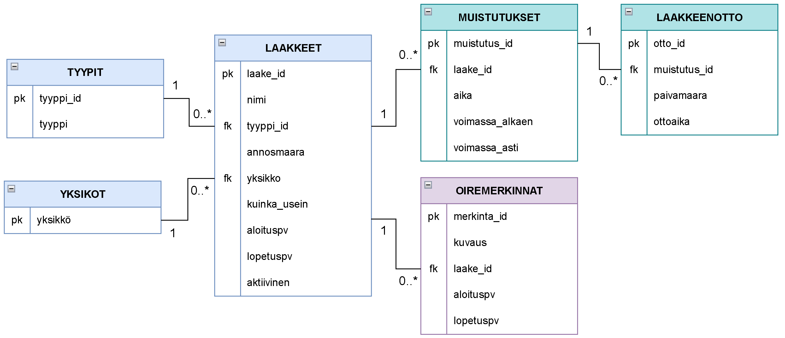

# LääkeKamu – Data Model

The database layout of the app. Table and column names are Finnish because they are the identifiers used in the code; the descriptions are in English. Domain terms: *lääke* = medication, *muistutus* = reminder, *annos* = dose, *oire* = symptom.

## Overview

| Item | Value |
|---|---|
| Database | SQLite through Room 2.8.5 (`fi.hh.laakekamu.data.AppDatabase`), encrypted with SQLCipher |
| File | `laakekamu.db` in the app's private `databases/` folder |
| Room version | 1 (kept at 1 until release, see [Versioning](#versioning-and-migrations)) |
| Schema export | `app/schemas/fi.hh.laakekamu.data.AppDatabase/1.json` (tracked in git) |
| Tables | 6: `Tyypit`, `Yksikot`, `Laakkeet`, `Muistutukset`, `Laakkeenotto`, `Oiremerkinnat` |
| Where the data lives | On the phone only. No INTERNET permission, no backup (`allowBackup="false"`) |

The tables are created by Room from the Kotlin `@Entity` classes in `data/entity/`.

## Entity relationship diagram

## Data dictionary

Legend: **PK** primary key, **FK** foreign key, **X** required (NOT NULL). The type is the SQLite type, with the Kotlin type in parentheses.

### Tyypit

Medication form picklist (the Type dropdown in *Add medication*). Seeded when the database is created; the app never edits it.

| Column | Type | Required | Description |
|---|---|---|---|
| `tyyppi_id` PK | INTEGER (`Long`), AUTOINCREMENT | X | Unique id of the type |
| `tyyppi` | TEXT (`String`), UNIQUE | X | Form of the medication, e.g. tablet, liquid |

Seeded values: tabletti, kapseli, neste, voide, tipat, inhalaatio, jauhe.

### Yksikot

Dose unit picklist. Natural key: `Laakkeet` stores the unit as text.

| Column | Type | Required | Description |
|---|---|---|---|
| `yksikko` PK | TEXT (`String`) | X | Dose unit, e.g. mg, ml |

Seeded values: mg, g, mcg, ml, %, kpl, tippaa.

### Laakkeet

The user's medications. Deleting is a soft delete (`aktiivinen = 0`) so the history is kept.

| Column | Type | Required | Description |
|---|---|---|---|
| `laake_id` PK | INTEGER (`Long`), AUTOINCREMENT | X | Unique id of the medication |
| `nimi` | TEXT (`String`) | X | Name, at most 150 characters, stored trimmed. Must not match another active medication (case-insensitive) |
| `tyyppi_id` FK → `Tyypit` | INTEGER (`Long`) | X | Form of the medication |
| `annosmaara` | TEXT (`String`) | X | Dose amount as free text, e.g. "5" or "2 x 2,5" |
| `yksikko` FK → `Yksikot` | TEXT (`String`) | X | Dose unit |
| `kuinka_usein` | TEXT (`KuinkaUsein`) | X | `PAIVITTAIN` (daily) = has reminder times and appears on Home; `TARVITTAESSA` (as needed) = no reminders, not on Home |
| `aloituspv` | INTEGER (`LocalDate`) | X | First day of the treatment |
| `lopetuspv` | INTEGER (`LocalDate?`) | | Last day of the treatment. NULL = ongoing. Must be ≥ `aloituspv` |
| `aktiivinen` | INTEGER (`Boolean`), default 1 | X | 1 = in use, 0 = deleted (hidden from the list; past doses still show) |

### Muistutukset

Reminder times of a daily medication. One medication can have several. Each row has a validity period: when a time is changed or removed after it has already been due, the old row is closed (`voimassa_asti` is set) instead of edited, so past days keep their original doses. A reminder with no history yet (nothing due before today and not taken today) is edited or deleted in place (`MuistutusRules.kt`).

| Column | Type | Required | Description |
|---|---|---|---|
| `muistutus_id` PK | INTEGER (`Long`), AUTOINCREMENT | X | Unique id of the reminder |
| `laake_id` FK → `Laakkeet` | INTEGER (`Long`) | X | The medication being reminded about |
| `aika` | INTEGER (`Int`) | X | Time of day in minutes after midnight, 0–1439 (480 = 08:00) |
| `voimassa_alkaen` | INTEGER (`LocalDate`) | X | First day the reminder is valid |
| `voimassa_asti` | INTEGER (`LocalDate?`) | | Last valid day, inclusive. NULL = until further notice (the current reminder). Must be ≥ `voimassa_alkaen` |

### Laakkeenotto

Doses taken. A row means the dose was taken; no row means it was not. Undoing a confirmation deletes the row.

| Column | Type | Required | Description |
|---|---|---|---|
| `otto_id` PK | INTEGER (`Long`), AUTOINCREMENT | X | Unique id of the record |
| `muistutus_id` FK → `Muistutukset` | INTEGER (`Long`) | X | Which dose (reminder) was taken |
| `paivamaara` | INTEGER (`LocalDate`) | X | The day the dose belongs to. Can differ from the day it was confirmed, when a past day is confirmed afterwards |
| `ottoaika` | INTEGER (`Instant`) | X | When the user confirmed the dose |

`UNIQUE (muistutus_id, paivamaara)` prevents recording the same dose twice. Inserts use `OnConflictStrategy.IGNORE`, so a double tap, or a notification and the app confirming at the same time, cannot crash the app.

### Oiremerkinnat

Symptom diary entries. The optional `laake_id` marks the symptom as a side effect of a medication.

| Column | Type | Required | Description |
|---|---|---|---|
| `merkinta_id` PK | INTEGER (`Long`), AUTOINCREMENT | X | Unique id of the entry |
| `kuvaus` | TEXT (`String`) | X | Description of the symptom, not empty |
| `laake_id` FK → `Laakkeet` | INTEGER (`Long?`) | | Medication the side effect belongs to. NULL = not a side effect |
| `aloituspv` | INTEGER (`LocalDate`) | X | First day of the symptom |
| `lopetuspv` | INTEGER (`LocalDate?`) | | Last day of the symptom. NULL = ongoing. Must be ≥ `aloituspv` |

## Foreign keys and deletes

Room turns SQLite foreign key checking on (`PRAGMA foreign_keys = ON`).

| Foreign key | When the referenced row is deleted |
|---|---|
| `Laakkeet.tyyppi_id` → `Tyypit` | Blocked (NO ACTION). Picklists are never deleted |
| `Laakkeet.yksikko` → `Yksikot` | Blocked (NO ACTION) |
| `Muistutukset.laake_id` → `Laakkeet` | CASCADE: the medication's reminders are deleted |
| `Laakkeenotto.muistutus_id` → `Muistutukset` | CASCADE: the reminder's records are deleted |
| `Oiremerkinnat.laake_id` → `Laakkeet` | SET NULL: the entry stays but is no longer a side effect |

The app never deletes `Laakkeet` rows (soft delete), so CASCADE and SET NULL protect integrity but do not fire in normal use. A reminder row is deleted only when it has no history yet (see `Muistutukset`).

## Constraints: where they are enforced

Room entities cannot declare CHECK constraints, so those rules are checked in Kotlin before saving (unit-tested functions in the `domain/` package).

| Constraint | Enforced by |
|---|---|
| PK, FK, NOT NULL, UNIQUE (`Tyypit.tyyppi`, `Laakkeenotto`) | SQLite |
| `kuinka_usein IN ('PAIVITTAIN', 'TARVITTAESSA')` | Kotlin type system (`enum class KuinkaUsein`, stored by name) |
| `aktiivinen IN (0, 1)` | Kotlin type system (`Boolean`) |
| `aika BETWEEN 0 AND 1439` | `isValidReminderTime` (`LaakeValidators.kt`) |
| `lopetuspv IS NULL OR lopetuspv >= aloituspv` (Laakkeet, Oiremerkinnat) | `isValidDateRange` (`LaakeValidators.kt`), repositories |
| `voimassa_asti IS NULL OR voimassa_asti >= voimassa_alkaen` | `isValidDateRange` and the reminder history rules (`MuistutusRules.kt`) |
| Name unique among active medications, at most 150 characters | `validateName`. Kotlin's `lowercase()` handles ä/ö; SQLite's NOCASE only handles ASCII |
| Symptom description not blank | `OireRepository` (`require`) and the add-symptom form |

## Indexes

| Index | Table (columns) | Unique | Purpose |
|---|---|---|---|
| `index_Tyypit_tyyppi` | Tyypit (`tyyppi`) | yes | Each type only once |
| `idx_laakkeet_tyyppi_id` | Laakkeet (`tyyppi_id`) | | Foreign key |
| `idx_laakkeet_yksikko` | Laakkeet (`yksikko`) | | Foreign key |
| `idx_muistutukset_laake_id` | Muistutukset (`laake_id`) | | Foreign key; looking up a medication's reminders |
| `index_Laakkeenotto_muistutus_id_paivamaara` | Laakkeenotto (`muistutus_id`, `paivamaara`) | yes | Each dose only once per day. Also covers the foreign key |
| `idx_oiremerkinnat_laake_id` | Oiremerkinnat (`laake_id`) | | Foreign key |

## Dates and times

SQLite has no date type, so `Converters.kt` stores them as integers.

| Kotlin | SQLite | Example |
|---|---|---|
| `LocalDate` | INTEGER, epoch day (days since 1 Jan 1970) | 1 Jan 2026 = 20454 |
| `Instant` | INTEGER, epoch milliseconds (UTC) | the moment of confirmation |
| `Int` (time of day) | INTEGER, minutes after midnight | 08:00 = 480 |
| `Boolean` | INTEGER 0/1 | `aktiivinen` |
| `KuinkaUsein` | TEXT, enum name | `PAIVITTAIN` |

The time of day and the date are stored without a time zone, and the alarm moment is computed in the phone's current time zone, so daylight saving time and travel do not shift a dose.

## How a dose's status is derived

The tables store only facts; what the screens show is computed by the rules in `domain/`:

- **A dose exists on day d** when `voimassa_alkaen ≤ d ≤ voimassa_asti` (NULL = no end) **and** `aloituspv ≤ d ≤ lopetuspv` (NULL = no end). For past days `aktiivinen` is ignored, so a deleted medication's history stays visible.
- **Dose status:** `OTETTU` (taken) if a `Laakkeenotto` row exists; `OTTAMATTA` (missed) if there is none and the dose time has passed; otherwise `TULOSSA` (upcoming).
- **Day complete:** the day has at least one dose and all of them are `OTETTU`.

## Seed data

`SeedCallback.onCreate` (`AppDatabase.kt`) inserts the `Tyypit` and `Yksikot` rows when the database file is first created. The other tables start empty.

## Data access objects

| DAO | Tables | Used for |
|---|---|---|
| `ValintaDao` | Tyypit, Yksikot | Dropdown lists |
| `LaakeDao` | Laakkeet | Insert, edit, active and all medications |
| `MuistutusDao` | Muistutukset | Current and all reminders, history-preserving changes |
| `LaakkeenottoDao` | Laakkeenotto | Confirm, undo, records for a date range |
| `OiremerkintaDao` | Oiremerkinnat | Symptom diary |

Screens reach the database through repositories (`RoomLaakeRepository`, `AnnosRepository`, `OireRepository` and `PaivakirjaRepository`). The database is opened lazily on first use (`AppContainer.database()`), not at app start.

## Versioning and migrations

- The Room version is **1** until release: the validity columns were part of the first implementation.
- `exportSchema = true`: the schema is exported to `app/schemas/fi.hh.laakekamu.data.AppDatabase/1.json` (identityHash `101316c793c37f22e367d56cac69984d`).
- If the schema changes, bump the version and add a `Migration` or `@AutoMigration`, tested with `MigrationTestHelper`. `fallbackToDestructiveMigration()` is forbidden in all builds because it would delete the user's medication data.

## Encryption and privacy

The whole database file is encrypted with SQLCipher (`sqlcipher-android` 4.17.0).

- A random 32-byte key is generated once and wrapped with an Android Keystore AES-256-GCM key. The wrapped key is stored in the app's private SharedPreferences (`SqlCipherKey.kt`).
- The Keystore key requires neither user authentication nor an unlocked device, so reminders can open the database on a locked phone. This is a deliberate security-versus-availability trade-off.
- A raw key (`x'<64 hex>'`) is used, so SQLCipher skips its slow key derivation and the database opens quickly enough for alarm receivers.
- A plaintext database left from development builds is converted once to an encrypted one with all rows kept (`SqlCipherSetup.encryptPlaintext`).
- If the database cannot be opened (for example the Keystore key is gone), the app shows an error screen (`TietokannanTila`). The user can retry or start over; data is deleted only after the user confirms.
- The app has no INTERNET permission and does not back up its data: `allowBackup="false"`, and `data_extraction_rules.xml` / `backup_rules.xml` exclude every domain from cloud backup and device transfer. An encrypted database restored without its Keystore key would be unreadable anyway.

## Changes from the requirements data dictionary

The original data dictionary (v1) was changed during design (v2):

| v1 | v2 | Reason |
|---|---|---|
| Dose time and frequency in both `Laakkeet` and `Muistutukset` | `aika` only in `Muistutukset`, `kuinka_usein` only in `Laakkeet` | Each fact in one place. An as-needed medication has no reminders |
| `Laakkeenotto` referenced the medication and had a taken/skipped `status` | References the reminder and the day, UNIQUE. A row means taken | A skipped dose is inferred from a missing row |
| `Oireet`, `Oiremerkinnat`, `Sivuoireet` | One `Oiremerkinnat` table with an optional `laake_id` | Simpler structure for the same data |
| `annosmäärä` DECIMAL(10,2) | `annosmaara` TEXT | Doses such as "2 x 2,5" |
| VARCHAR, TIMESTAMP | TEXT, INTEGER (epoch day / millis / minutes) | SQLite has no such types |
| – | `aktiivinen` | Soft delete keeps history |
| `onko_paalla` | `voimassa_alkaen`, `voimassa_asti` | Changes do not rewrite the history of past days |
| `tyyppi` as a text PK | `tyyppi_id` PK + `tyyppi` UNIQUE | Integer key for the foreign key |
| – | CHECK rules (as Kotlin validators, see [Constraints](#constraints-where-they-are-enforced)) and foreign key indexes | Data integrity and faster joins |
